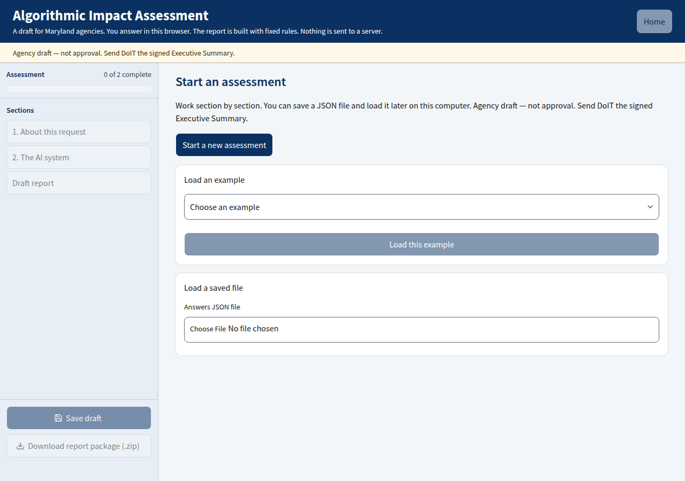
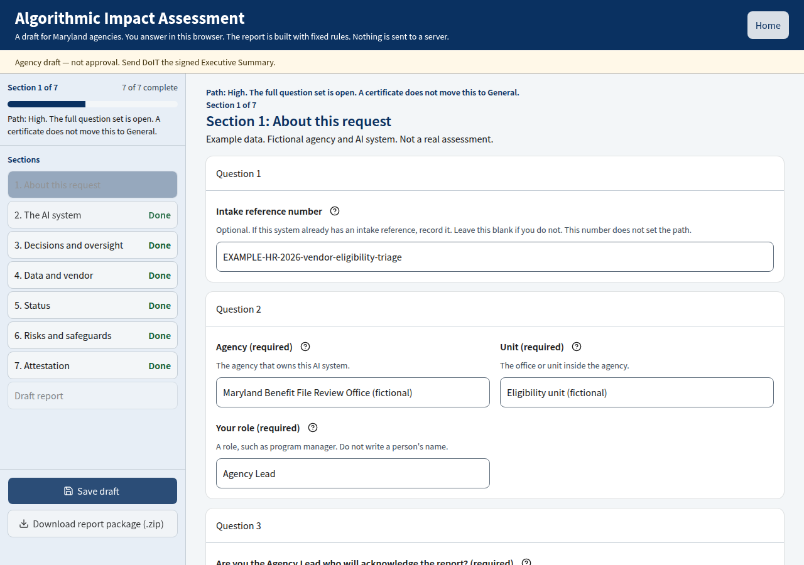
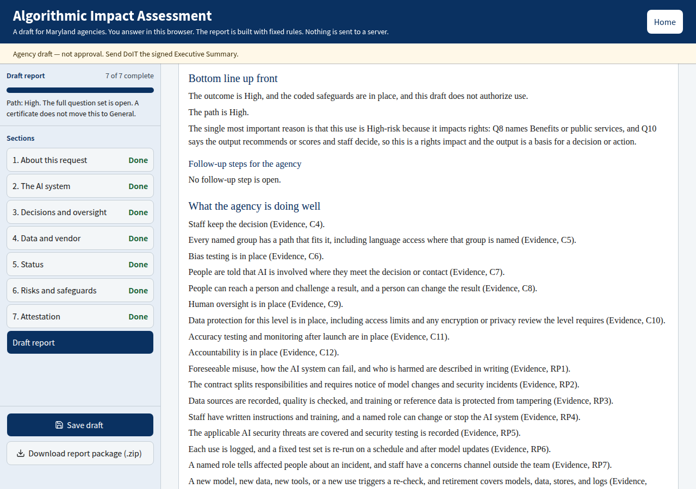
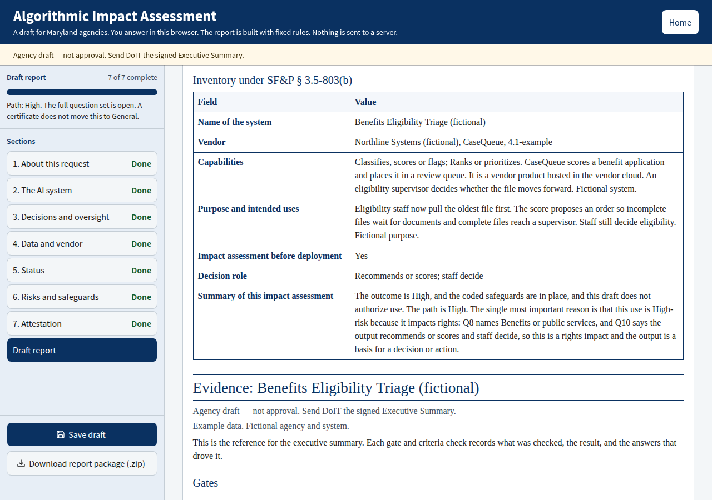

# Maryland Algorithmic Impact Assessment

Use this tool to draft an Algorithmic Impact Assessment (AIA) for an artificial intelligence (AI) system at a Maryland state agency.

You answer a form in your browser. The page writes the draft from your answers with fixed rules. Nothing is sent to a server.

Open the tool: [https://dexcopeland.github.io/AIA-Reports-Testing/](https://dexcopeland.github.io/AIA-Reports-Testing/)

Every screen shows this line: **Agency draft — not approval. Send DoIT the signed Executive Summary.** DoIT is the Maryland Department of Information Technology.

The package is an agency draft. It does not approve the system. It does not authorize your agency to buy, use, or deploy the system. The website does not send the package to DoIT. You send the signed Executive Summary.

## Contents

- [What this tool is for](#what-this-tool-is-for)
- [Who should use it, and when](#who-should-use-it-and-when)
- [What to have ready](#what-to-have-ready)
- [Open the tool](#open-the-tool)
- [Complete the assessment](#complete-the-assessment)
- [How the tool chooses High or General](#how-the-tool-chooses-high-or-general)
- [Prohibited uses](#prohibited-uses)
- [Vendor certificates](#vendor-certificates)
- [What you receive](#what-you-receive)
- [Where your answers live](#where-your-answers-live)
- [For maintainers](#for-maintainers)

## What this tool is for

The tool is the in-browser form an agency uses to prepare an AIA. You describe the AI system, the people it affects, and the safeguards you have. The page then drafts four documents.

The draft follows the shape of Maryland's published AI rules. Those include the State Finance and Procurement Article (SF&P) §§ 3.5-801, 3.5-803, 3.5-804, and 3.5-805, and DoIT's [Responsible AI Policy](https://doit.maryland.gov/policies/ai/Pages/maryland-responsible-ai-policy.aspx) (Version 1.0, issued 23 May 2025) and its [implementation guidance](https://doit.maryland.gov/policies/ai/Pages/maryland-responsible-ai-policy-implementation-guidance.aspx).

Some question wording and scoring rules are still proposals. The tool uses them so you can finish a draft. The report says when a finding is recommended practice rather than a State rule. The proposed list is in [`content/RULES.md`](content/RULES.md).

## Who should use it, and when

Use it if you are Maryland state agency staff preparing an AIA for an AI system your agency may buy, build, or use.

Use it when the system is still in planning or procurement. Also use it when the system is already in a pilot or in live use. On a High or Prohibited path, Pilot and Live ask whether an impact assessment was done before deployment.

You do not have to be the Agency Lead to fill in the form. The Agency Lead still signs the Executive Summary. The form asks for that person's name, role, and email either way. The report prints all three in the acknowledgment.

## What to have ready

Gather what you know about the system before you start. You can leave a fact blank and come back. A blank required answer is treated as a gap.

Have these ready:

- Your agency, unit, and role. Write a role, such as program manager. Do not write a person's name in a role field.
- Whether you are the Agency Lead, and the Agency Lead's name, role, and email. The report prints all three with the signature.
- The name of the AI system.
- Who built it. If a vendor is involved, have the vendor, product, and version.
- What the system does, and the process it changes.
- Whether any prohibited use applies. The list is [below](#prohibited-uses).
- Which areas of life the output can affect, and whether it acts on individual people.
- Whether the output decides, recommends or scores, or only gives information to staff.
- The kinds of data it uses, and the data level if you know it.
- Any vendor certificate, and whether that certificate covers this product.
- On a High or Prohibited path, the deployment status: Planning, Procuring, Pilot, or Live.

The questions ask about the AI system. Do not paste a resident's case file, a person's case notes, or other resident data into an answer.

An intake reference number is optional. It appears only on the High and Prohibited paths. It does not set the path.

## Open the tool

Go to [https://dexcopeland.github.io/AIA-Reports-Testing/](https://dexcopeland.github.io/AIA-Reports-Testing/).

You can also run a copy on your own computer. See [Run it on your computer](#run-it-on-your-computer).



The start screen gives you four ways in:

1. **Start a new assessment.** This clears the copy stored in this browser.
2. **Continue saved draft.** This appears when this browser already has answers. It restores that copy.
3. **Load an example.** These are fictional drafts, so you can see how a finished form looks. Each title names the path: High-risk, General Impact Assessment, or Prohibited. The screen says the agency and system are fictional. Do not file an example as your agency's assessment.
4. **Load a saved file.** Choose an answers file you saved earlier. The file is JSON (a text file of your answers).

## Complete the assessment

### Work section by section

A rail on the left lists the sections that apply to your answers. **Save draft** and **Download report package (.zip)** sit at the bottom of that rail.

Before the path is set, the rail shows two sections:

1. About this request
2. The AI system

Answer those. The path is set from the facts in the AI system section. Once the path is General, High, or Prohibited, the later sections open.

On a **High** or **Prohibited** path, the rail shows seven sections:

1. About this request
2. The AI system
3. Decisions and oversight
4. Data and vendor
5. Status
6. Risks and safeguards
7. Attestation

On a **General** path, Status stays closed. The rail shows the other six sections, and each section uses the shorter question set. Hosting, procurement timing, threat protections, contract-term statements, and the longer safeguard list stay closed.

Some questions appear only when an earlier answer makes them apply. A vendor question stays hidden when the State built the system with no vendor and no outside model. An in-scope certificate can hide questions it covers. See [Vendor certificates](#vendor-certificates).

Each question sits on its own card. Short fields in the same question can sit side by side on a wide screen.



The screenshot uses the fictional example "Benefits Eligibility Triage." Your assessment will show your own answers.

Many safeguard questions are a set of statements. The lines run from a weaker practice to a stronger one, and the last line is "We don't know / not determined yet." Some lines ask for a target date. The strongest line can ask for one short line of evidence.

Choose **Save and continue** to move ahead. The browser saves when you continue. If a required answer is still blank, the page lists it. You can continue. A blank answer counts as a gap. On the last section, the button says **Review and create draft**.

You can open a section you have already reached, and any section that has no blank required answers. Other sections stay closed until you reach them. After the draft report is open, you can open any section in the rail. **Back** returns to the previous section.

Above the section title, and again in the rail, the page names the path: not set yet, General, High, or Prohibited.

### Save your work

The browser keeps a working copy as you answer. The page says **Saved in this browser.**

**Save draft** downloads an answers file to your computer. The name looks like `AIA-answers-Benefits-Eligibility-Triage.json`. Keep that file with your agency records. You need it to resume on another computer.

The file records three version numbers: `schema_version`, `form_version`, and `rules_version`.

If you choose **Home** after you change an answer, the page asks whether to download the file first. The working copy in this browser stays either way. **Stay** returns you to the form.

If this browser cannot store the draft, the page says: "This browser did not keep that draft. Use Save JSON file to keep it." Choose **Save draft** and keep the downloaded file.

**Start a new assessment** clears the working copy in this browser. Download a file first if you still need those answers.

### Resume from a saved file

On this same browser and computer, choose **Continue saved draft**.

On another computer, or after you clear this browser's site data, use **Load a saved file** and pick the JSON file. You can load a file from the start screen or from inside the form.

The page accepts an answers file from this tool when the schema major version matches. It then scores the file with the current rules. If the file is not an answers file, the page says so and leaves your current draft in place.

Continuing a draft or loading a file returns you to the form. Choose **Review and create draft** on the last section to open the draft report again.

### Open the draft report

**Review and create draft** opens the draft report. You can also choose **Draft report** in the rail after that.

Read the draft on screen before you download. If required answers are still blank, a notice counts them. Blank answers are treated as gaps, or as not yet in place.

In the Executive Summary, complete the sign-off before you download:

- For each recommended mitigation, choose Yes or No, pick the date, and type a comment if you have one.
- Check the Agency Lead's name, role, and email. They come from the form and are printed in the acknowledgment. You can correct them here.
- Pick the date next to that name.
- Leave the signature blank. Sign by hand on the printed copy, or in the signature field of the PDF (Portable Document Format).

Those entries are saved in the answers file. The signature is never stored.

The on-screen draft shows all four documents on one page. **Draft checks** is a mechanical check of that draft. A pass there is not an approval.

### Download the zip

Choose **Download report package (.zip)** at the bottom of the rail.

Confirm the attestation (question 25) first. Until you do, the zip stays off. The page says: "The report package stays off until Q25 is confirmed." You can still read the on-screen draft. The tool labels that block as a proposed rule.

The zip is built in your browser. It holds four PDFs and the same four documents as Word files. The names come from the system name. A file looks like `Benefits-Eligibility-Triage-fictional-1-Executive-Summary.pdf`. The zip looks like `Benefits-Eligibility-Triage-fictional-report-package.zip`.

Each PDF is US Letter. The header names the system and the document. The footer shows the report date and the page number, in the form "Page 1 of 4."

If a character is missing from the report fonts, the page names that character and the question after the download.

Downloading does not send anything to DoIT.

## How the tool chooses High or General

The path comes from facts in your answers. A certificate never moves a High path to General. The path line on a High assessment says so.

Answer the path questions in **The AI system**. Until those facts are complete, the path line starts with **Path: not set yet** and the later sections stay closed. If you say the system ranks or prioritizes, and you have not said what the output acts on, the path also stays unset.

| Path        | What you will see                                       |
| ----------- | ------------------------------------------------------- |
| Not set yet | Only the opening sections. Finish the path questions.   |
| General     | The shorter question set. Status stays closed.          |
| High        | The full question set, including Status.                |
| Prohibited  | The full question set stays open. A listed use applies. |

The path is **Prohibited** when you select a use on the prohibited list. See [Prohibited uses](#prohibited-uses).

The path is **High** when any of these is true:

- You mark prohibited use as Unknown. Unknown is not a confirmed prohibition.
- You mark the affected area as Unknown.
- You mark the decision role as Unknown.
- The output can affect health or access to health care, people's physical safety, or critical infrastructure. That is a safety impact. It sets High even when the output only gives information to staff.
- The output can affect a rights area, and the output is a basis for a decision or action. A basis means the output decides or acts on its own, or it recommends or scores and staff decide. Information that staff do not act on is not a basis.
- The system identifies people from faces, voices, or other body features, or it ranks or prioritizes individual people, and that output is a basis for a decision or action. Ranking places, areas, or groups does not by itself meet this test. This High trigger is separate from the prohibited-use list.

Rights areas are: benefits or public services, housing, money or legal rights, jobs or employment, police, corrections or community supervision, investigations, identifying people, automated enforcement that leads to tickets or citations, speech, assembly or religion, and privacy.

The path is **General** when the path questions are complete and no High or Prohibited fact applies. The shorter question set opens. "None of these" on prohibited use does not by itself make the path High.

## Prohibited uses

Question 7 lists the five Prohibited Uses from the Responsible AI Policy, Version 1.0, issued 23 May 2025, plus **None of these** and **Unknown**. The form shows the policy's sentences. The five uses are:

1. Real-time and covert biometric identification of a person, including facial recognition and iris scanning, without that person's knowledge or meaningful consent.
2. Emotion analysis that classifies facial expressions, body movements, or language into emotions or sentiments.
3. Fully automated decisions, including agentic AI, that fall under the Unacceptable Risk uses on that policy page. In the policy sentence, "outlined above" means that Unacceptable Risk tier.
4. Social scoring that tracks and classifies people based on behavior, socioeconomic status, or personal characteristics.
5. Cognitive behavioral manipulation of people or specific vulnerable groups.

A selected use sets the path to Prohibited. The full question set stays open. The form does not approve or reject the system. The draft tells the agency to stop that use before any use.

The policy page is [Maryland's Responsible AI Policy](https://doit.maryland.gov/policies/ai/Pages/maryland-responsible-ai-policy.aspx).

## Vendor certificates

The certificate questions stay hidden when the system was built by the State with no vendor and no outside model. In every other case, the form asks which certificates were given, and whether they cover this product.

These certificates can shorten overlapping questions and soften a related risk:

- SOC 2 (System and Organization Controls 2)
- FedRAMP (Federal Risk and Authorization Management Program)
- StateRAMP (State Risk and Authorization Management Program)
- ISO/IEC 27001 (an international information-security standard)
- ISO/IEC 42001 (an international AI management-system standard)
- AIUC-1

**None** and **Unknown** never count. Credit applies only when those questions are on the form, you select one of those certificates, and you say it covers this product.

A credited line in Evidence is marked "Credited (in-scope …)." The certificate does not mark the control fully met. It does not close the item by itself. Confirm that it applies to this product.

A certificate cannot move High to General. It does not skip these questions:

- Prohibited use, affected areas, and the decision role
- Human review of outputs that have consequences
- Data level and special data rules
- Training on State data
- Limits on documents the system pulls into its answers
- Accuracy testing for this workflow
- Deployment approval

A certificate alone does not satisfy the contract-term statements.

## What you receive

The zip holds four documents. You also get each one as a Word file and as a PDF. The on-screen draft shows the same four, one after another.

Each document starts with the banner: **Agency draft — not approval. Send DoIT the signed Executive Summary.** An example also says the agency and system are fictional.


### Executive Summary

This is the document the Agency Lead signs.

It includes:

- A purpose section, "About this summary." It says the summary is for the agency, that it is not an approval, that the Agency Lead signs, that you keep the full package in agency records, and that you send DoIT a copy of the signed Executive Summary. It also says DoIT did not check that your answers are accurate.
- The system name, agency, capabilities, purpose, deployment, and decision role. On a High or Prohibited path, it includes the intake reference if you entered one.
- A deadline line tied to SF&P § 3.5-803(e). When the date depends on the procurement date, the line says DoIT AI Governance will confirm it. A system built by the State, with no vendor and no outside model, does not get a date from that subsection.
- The bottom line up front (BLUF). That block is three sentences: the outcome, the path, and the single most important reason. Follow-up steps come after those three sentences. If nothing is open, the draft says no follow-up step is open.
- What is in place, where there is room for improvement, and the risks with recommended mitigations. Each item names the Evidence section it comes from.
- The mitigation acknowledgments and the Agency Lead acknowledgment. That block prints the signer's name, role, and email, then the signature line.
- On a High path only, an inventory table under SF&P § 3.5-803(b). A General or Prohibited path does not include that table.



The High-only inventory table has these rows: name of the system, vendor, capabilities, purpose and intended uses, impact assessment before deployment, decision role, and a summary made from the three BLUF sentences. The capabilities row can also include the longer system description when you answered that question.



The statute text is [SF&P § 3.5-803](https://mgaleg.maryland.gov/mgawebsite/Laws/StatuteText?article=gsf&section=3.5-803&enactments=false).

**What to do with it.** The Agency Lead signs the acknowledgment. Sign the printed copy by hand, or sign the PDF signature field. Keep a copy with the rest of the package. Send DoIT a copy of the signed Executive Summary. This website does not send it.

### Evidence

Evidence is the reference for the Executive Summary. For each gate and criteria check, it records what was checked, the result, and the answers that drove it. It also records prohibited use, data level, and the recommended-practice checks.

Recommended-practice checks draw on ISO/IEC 42001 and ISO/IEC 27090. DoIT has not adopted those standards as policy. Those findings are recommendations.

When an in-scope certificate covers a line, Evidence marks it credited. See [Vendor certificates](#vendor-certificates).

**What to do with it.** Keep it in the agency's records with the rest of the package. Use it when someone asks what an Executive Summary line was based on.

### Assessment Submission Record

This document lists every question and the answer you gave, in order. It names the system and the date saved on the answers file. Answers are copied as you entered them.

The date is the save date. It does not mean the file was sent to DoIT.

**What to do with it.** Keep it in the agency's records. It is the copy of what you answered.

### Follow-Up Actions

This document lists the follow-up steps, one sentence each. It shows the owner and the due date when the assessment has them. Each step names the Evidence section it comes from. If nothing is open, it says no follow-up step is open.

**What to do with it.** Keep it in the agency's records. Use it to assign the open work. The owner and target date for each recommended mitigation also belong in the Executive Summary acknowledgment.

## Where your answers live

Your answers stay in this browser on this computer. The page stores a working copy in the browser's local storage. Nothing is sent to a server. The header says so.

**Save draft** and **Download report package (.zip)** write files on your computer. You choose where to keep them. The Word files and PDFs are built in the browser.

The working copy is tied to this browser on this computer. Another browser, another computer, or clearing this site's data removes it. Keep the JSON file if you need to resume.

The Agency Lead's name, role, and email are in the JSON file and in the report. The acknowledgment in the Executive Summary prints all three. The Submission Record copies them with the other answers.

The date and mitigation comments are in the JSON file and in the Executive Summary. The signature is not stored.

Do not put resident data in the file. Role fields ask for a role, not a person's name. The form warns you when a role field looks like a person's name. The Agency Lead name is the exception. The report prints that name with the role and email.

## For maintainers

This section is for people who change the tool. Agency staff can stop at [Where your answers live](#where-your-answers-live).

The page is a client-side questionnaire with a JSON save file and deterministic scoring, in the shape of Canada's [AIA tool](https://github.com/canada-ca/aia-eia-js). The output here is the four-document package described above.

### Run it on your computer

You need Node.js 20 or newer. Continuous integration (CI) uses Node.js 22.

```bash
npm ci
npm test
npm run dev
```

Open the address Vite prints, [http://localhost:5173](http://localhost:5173). `npm run build` typechecks and writes the static site to `dist/`. `npm run preview` serves that folder.

### Scripts

| Script                 | What it does                                                                                                                                 |
| ---------------------- | -------------------------------------------------------------------------------------------------------------------------------------------- |
| `npm run dev`          | Starts the local site on port 5173.                                                                                                          |
| `npm run build`        | Typechecks, then writes `dist/`.                                                                                                             |
| `npm run preview`      | Serves `dist/`.                                                                                                                              |
| `npm test`             | Runs the unit tests and the screen tests.                                                                                                    |
| `npm run lint`         | Runs ESLint on the TypeScript and React sources.                                                                                             |
| `npm run format`       | Rewrites files with Prettier. Print width is 100.                                                                                            |
| `npm run format:check` | Checks Prettier without rewriting.                                                                                                           |
| `npm run typecheck`    | Runs the TypeScript compiler without emitting files.                                                                                         |
| `npm run validate`     | Rewrites [`docs/scenario-validation.md`](docs/scenario-validation.md).                                                                       |
| `npm run rules-index`  | Rewrites [`content/rules-index.json`](content/rules-index.json).                                                                             |
| `npm run examples`     | Rewrites `examples/` from [`src/examples/catalog.ts`](src/examples/catalog.ts).                                                              |
| `npm run smoke`        | Drives Chrome through an example, the draft report, and the zip download. Run `npm run preview` first. It needs Chrome and `puppeteer-core`. |

CI runs lint, the format check, tests, the three generators, and the build on every push and pull request. See [Content-sync checks](#content-sync-checks).

`npm test` covers scoring, the path, the BLUF, the zip package, storage, and the screens in jsdom. The screen tests include autosave, the failed-save notice, continuing with blanks, restoring the browser copy, and the sign-off edits.

[`docs/scenario-validation.md`](docs/scenario-validation.md) compares synthetic scenarios S01–S24 with their keys. On the checks that file lists, 24 of 24 match. S06, S12, and S24 also set an extra gate the key treats as arguable or possible. Those notes are not failures. The scenarios are fictional.

### Content-sync checks

Three committed files are generated. CI regenerates each one and fails if the committed copy differs.

| Command               | File that must match          |
| --------------------- | ----------------------------- |
| `npm run validate`    | `docs/scenario-validation.md` |
| `npm run rules-index` | `content/rules-index.json`    |
| `npm run examples`    | `examples/`                   |

Prettier ignores those generated files. After a content edit, run the matching command and commit the result.

### Project structure

Edit the data modules when you mean to change questions, rules, or report text. Edit the page layout only when the layout is the change.

| What                                                                 | File                                      |
| -------------------------------------------------------------------- | ----------------------------------------- |
| Version numbers                                                      | `src/content/types.ts`                    |
| Statement sets (32)                                                  | `src/content/statements.ts`               |
| Gates, mitigations, fixed paragraphs, sources, prohibited uses       | `src/content/rules.ts`                    |
| Option lists, including certificates                                 | `src/content/catalog.ts`                  |
| Form fields, help text, show and hide, High versus General questions | `src/content/form.ts`                     |
| Proposed rules                                                       | `content/RULES.md`                        |
| Finding sentences                                                    | `content/findings.json`                   |
| Path from the gate facts                                             | `src/engine/path.ts`                      |
| Certificate credit                                                   | `src/engine/credits.ts`                   |
| Scoring                                                              | `src/engine/evaluate.ts`                  |
| BLUF sentences                                                       | `src/engine/bluf.ts`                      |
| Report assembly                                                      | `src/engine/report.ts`                    |
| Zip package                                                          | `src/report/zip.ts`                       |
| Word and PDF layout                                                  | `src/report/style.ts`                     |
| Screens, rail, save, and zip actions                                 | `src/ui/`                                 |
| Example drafts                                                       | `src/examples/catalog.ts` and `examples/` |

Current versions in `src/content/types.ts`:

- Schema `1.0.0`. An answers file with the same major version still opens.
- Form `v2-structured-1.0.0`.
- Rules `1.2.1`.

Bump `RULES_VERSION` when a rule or statement changes. Loading a file stamps it with the current rules version. The Executive Summary shows a response ID. It does not print the rules version. If the answers have no response id, the id is `DRAFT-` plus a fingerprint of the answers. That fingerprint lets you compare two runs of the same file. It is not a seal.

Unknown counts as a gap for a criterion, and as not yet for recommended practice. The access-path items 12d and 12e are the exception: unknown there is Partial. The answer "There is no path that fits this group" is also Partial. The mitigation list is capped at 3, including one Ongoing item, when no C4–C12 item is Gap and no recommended-practice item is Not yet. The cap and the other proposed rules are described in [`content/RULES.md`](content/RULES.md).

Word files ask for Times New Roman. That font is not in this repository. PDFs embed Liberation Serif, under the SIL Open Font License, from `src/fonts/`. Characters that font lacks are drawn from DejaVu Serif, under the Bitstream Vera license in the same folder. The zip is built in the browser with `fflate`, loaded only when someone downloads a package.

The screens use React, Vite, TypeScript, and shadcn/ui with Tailwind. The palette is Maryland navy. The UI font is Source Sans Pro. Scoring and report assembly stay in framework-free modules.

### Examples

`examples/index.json` lists 14 fictional drafts in three groups: **Built by the State**, **A vendor product**, and **Path examples**. Each title starts with the path the answers produce: `High-risk:`, `General Impact Assessment:`, or `Prohibited:`. The dropdown loads those JSON files.

`npm run examples` rewrites the folder from `src/examples/catalog.ts`. The screen tests expect those path labels.

The screenshots in `docs/images/` were taken from the local app with the fictional Benefits Eligibility Triage example. Retake them when the screen layout changes.

### How to change questions and rules

1. Edit the module in the table above. Leave the layout alone unless the layout is the change.
2. Bump `RULES_VERSION` when a rule or statement changes.
3. Run `npm test`, `npm run lint`, and `npm run format:check`.
4. If you changed content a generator owns, run `npm run validate`, `npm run rules-index`, or `npm run examples`, and commit the generated file.
5. Open a pull request.

Do not put resident data in examples, tests, or screenshots. Keep example agencies and systems fictional, and keep the example label on those drafts.

### GitHub Pages

[`.github/workflows/pages.yml`](.github/workflows/pages.yml) runs the checks above on pull requests. On a push to `main`, it deploys `dist/` to GitHub Pages.

The live site is [https://dexcopeland.github.io/AIA-Reports-Testing/](https://dexcopeland.github.io/AIA-Reports-Testing/).

For a new copy of the repository, turn Pages on once:

1. GitHub, this repository, Settings, Pages.
2. Build and deployment, Source: **GitHub Actions**.

Asset paths are relative (`base: "./"` in `vite.config.ts`), so the same build works at that project URL and on a local preview.

### Follow-up work

Open items are listed in [`ROADMAP.md`](ROADMAP.md).
